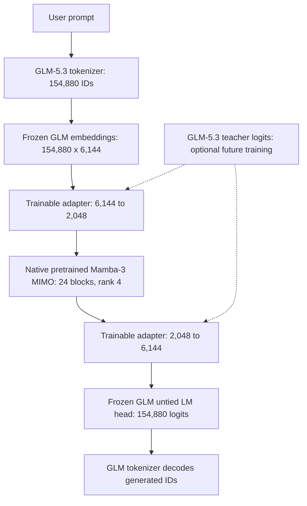

# IQ architecture decision — 17 November 2026

## Active experiment: GLM-5.3 lexical + native Mamba-3 MIMO

The **primary experimental student** uses GLM-5.3's official tokenizer, frozen
input embeddings and frozen untied output head with two trainable width adapters.
Its sequence backbone is the **24 original pretrained Mamba-3 MIMO blocks**, each
retaining the donor's original mixer and gated MLP. GLM attention and experts are
**not** present in this lane; their capabilities require independently validated
teacher distillation or post-training. This is not the 235-layer hybrid.



### Immutable boundaries

| Property | Active student | Legacy 235-layer full256 checkpoint | Native Mamba baseline |
| --- | --- | --- | --- |
| Tokenizer | GLM-5.3 | Mamba/Llama-compatible | Llama-3.1-compatible |
| Vocabulary IDs | 154,880 | 128,256 | 128,256 |
| Lexical embeddings/head | Original GLM frozen weights | Mamba-derived 4,096-wide tensors | Original Mamba tied weights |
| Internal model | Original 24 Mamba-3 MIMO blocks + 2 untrained adapters | 235 Mamba/CSA/HCA/MoE layers + AttnRes and recurrence | 24 original Mamba-3 MIMO blocks |
| GLM reasoning/skills | Not yet distilled | Weight-only transplantation, unproven retention | Not imported |
| Validated coherent inference | **No** | **No** | GPU validation still required |

**Do not load the legacy 128,256-ID full256 checkpoint through the 154,880-ID
GLM student loader.** Merely replacing the tokenizer would reassign word/token
meanings. The student also must not be described as retaining GLM's full
reasoning or MoE capability until measured distillation is completed.

### Weight provenance

- **GLM tokenizer, input embeddings and untied output projection:** official
  `zai-org/GLM-5.3-BF16`, revision
  `abf42e6c0e53bc29a875511301e7b7fcd220315b`.
- **Mamba backbone:** original `state-spaces/mamba3-mimo-1.5b`,
  revision `bc6b5d0f7994fe4cb3478242e92da8daf9ee29ec`.
- **Adapters:** randomly initialized / trainable; **not** pretrained GLM knowledge.
- **Legacy full256:** 235 layers, 20,283 indexed shards, 502.34 GiB in HF
  Bucket `kofecheckmate/iq-glm53-all256`, 128,256 IDs, weight-only compiler,
  explicitly `inference_ready=false`. Retain the artifact unchanged.

See `docs/GLM53_NATIVE_MAMBA3_STUDENT.md` for code and lexical-only shard
staging, and `docs/MAMBA3_PRETRAINED_RUNTIME.md` for native kernel limitations.

## Active code ownership

- `iq_model/glm_mamba3_student.py` — GLM tokenizer geometry, lexical weight
  adapters, original 24-block Mamba student.
- `scripts/iq_glm53_mamba3.py` — primary student preflight / explicit generation.
- `iq_training/glm_mamba3_distillation.py` — optional teacher-logit optimizer
  step; not a complete trained model or an automatic background job.
- `scripts/patch_iq_native_mimo_tail.py` — pinned native MIMO kernel bounds guard.
- `iq_transfer/mamba3_direct.py` — shared donor pin/constants; this is a
  utility dependency, **not** a request to run a legacy transplant.
- `tests/test_glm_mamba3_student.py` — synthetic CPU contract tests only.

The three package top-level `__init__.py` files export their existing public
symbols **lazily**: importing the active student no longer eagerly loads every
unrelated Phi/GPT-OSS/hybrid donor module.

## Research separated from the active student

Preserved for reproducibility, **not merged into the active student**:

- `iq_model/hybrid.py`, `iq_transfer/complete_transplant.py`, legacy 235-layer
  checkpoint, and the in-progress local `IQ-baseten-full` worktree.
- `iq_transfer/phi4.py`, `iq_transfer/phi_pipeline.py`,
  `iq_transfer/gpt_oss20b.py` and old transfer launchers.
- `nif_sovereign/` Mojo research (82 files) is retained on `main` and in Git\n  history but intentionally omitted from this student-only branch; alternative\n  attention/halting experiments remain separate.
- The earlier 80-layer `mocha` checkpoint and Baseten experiment branch.

**No history was deleted.** Only the active runtime import boundary was
refactored; more aggressive deletion requires import/CI coverage. The source
repository is about 1.9 MB tracked; it is the 502 GiB remote weight artifact
that dominates model storage.

## No-cost verification gates

From a clean worktree based on this branch:

```bash
python -m unittest discover -s tests -p 'test_lazy_public_api.py' -v
python -m scripts.iq_glm53_mamba3 --preflight
```

When PyTorch and project test dependencies are available, also run:

```bash
python -m unittest discover -s tests -p 'test_glm_mamba3_student.py' -v
```

The preflight uses no model weights or paid GPU. Do **not** use these CPU
contract tests as proof of full trained-model generation.

## Gates before paid inference or training

1. Pin and hash the actual GLM tokenizer mapping; verify lexical tensor identity.
2. Verify the native Mamba source kernel guard and compatible CUDA architecture.
3. Load the **whole** student with real Mamba + GLM lexical weights.
4. Evaluate real generation; if incoherent, run measured teacher distillation.
5. Trace model initialization, full forward, adapter gradients, logits and
   sampled output. Never log API keys, raw prompts or weight data.
6. Obtain explicit approval before a billed Baseten deployment.
